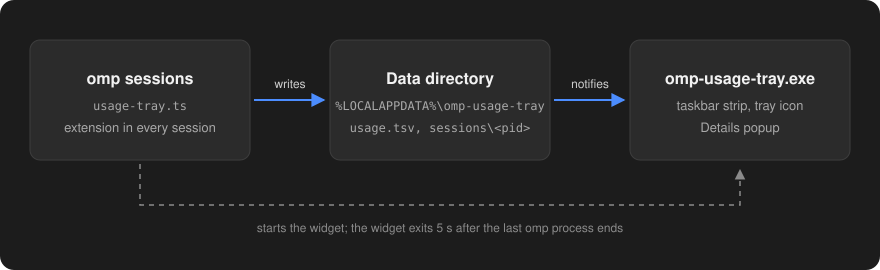

<div align="center">

# omp usage tray

A Windows taskbar widget that shows how much quota you have left with every provider logged into
[oh-my-pi (`omp`)](https://github.com/can1357/oh-my-pi).


</div>

## What it shows

Each provider has its logo between two arcs. The left arc and number are the 5-hour window, the right
ones the 7-day window, and under each number is the time until that window resets. The numbers are
what is left, so 100% means untouched.

Left click opens Details with the account, the clock time each limit resets, extra limits such as
Antigravity's second quota pool or Codex's gpt-reserve, and any provider that did not fit on the
taskbar. Right click opens a menu where you can move the widget to the left or right side of the
taskbar, or quit.

<p align="center">
  
</p>

The widget starts with the first omp session and exits 5 seconds after the last one closes. It follows
the light or dark taskbar theme and the display scaling. When the taskbar gets crowded, the providers
with the most quota left are hidden first. Screenshots use made-up data.

## Install

You need Windows 11 (Windows 10 is untested) and omp with at least one provider logged in. The widget
is compiled with the .NET Framework that ships with Windows, so there is nothing else to install.

```bat
git clone https://github.com/albmoss/omp-usage-tray.git
cd omp-usage-tray
install.cmd
```

`install.cmd` builds the widget into `%LOCALAPPDATA%\omp-usage-tray\` and copies the omp extension
to `%USERPROFILE%\.omp\agent\extensions\usage-tray.ts`. Restart open omp sessions so they load it.
Run `install.cmd` again after pulling updates, and `uninstall.cmd` to remove everything.

## How it works

<p align="center">
  
</p>

The extension reads the usage reports omp already caches for `omp usage` (refreshed about every
5 minutes) and writes them to `usage.tsv`. The widget redraws when that file changes and once a minute
for the countdowns. Neither part makes network requests, and the data, including the account emails
shown in Details, stays in `%LOCALAPPDATA%\omp-usage-tray\`.

## Limitations

- Only the primary display's taskbar, and only a horizontal one. With a vertical taskbar you still
  get the tray icon.
- The left position works only with a centered taskbar.
- A provider appears only if `omp usage` reports percentage limits for it.
- The extension uses omp's internal usage API, so an omp update may require an update here.

## Credits

Provider logos come from [Simple Icons](https://simpleicons.org) (Claude, Gemini, GitHub Copilot from
16.35.0, OpenAI from 15.22.0, CC0) and [Wikimedia Commons](https://commons.wikimedia.org/wiki/File:Google_Antigravity_Logo.svg)
(Antigravity). They are trademarks of their owners. This project is not affiliated with Anthropic,
OpenAI, Google or GitHub.

## License

[MIT](LICENSE)
