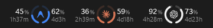
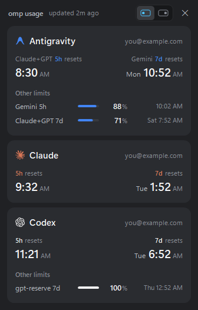
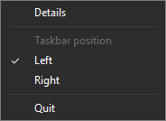
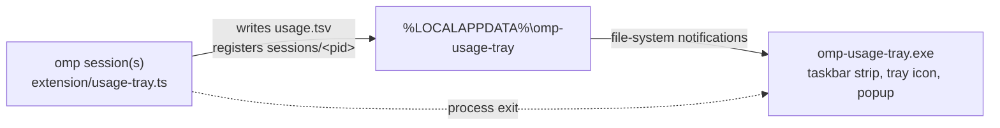

# omp usage tray

A small Windows taskbar widget that shows how much quota is left for every provider you are
logged into in [oh-my-pi (`omp`)](https://github.com/can1357/oh-my-pi): Claude, Codex,
Antigravity and any other provider that `omp usage` reports limits for.

It starts with the first `omp` session and exits a few seconds after the last one closes.



*Each provider shows both limits at once. The provider's mark sits between two arcs: the left arc and
the number on the left are the 5-hour window, the right arc and the number on the right the 7-day
window, with the time until each one resets below. Both arcs fill from the bottom up, so the lower
side stands out at a glance.*

 

*Left click opens Details with what the taskbar does not show: the account, the clock time each
limit resets at, and the limits behind the two numbers (Antigravity's second quota pool, Codex's
gpt-reserve). A provider that did not fit on the taskbar shows its percentages here. The switch at
the top moves the widget between the left and right side of the taskbar. Right click opens the menu.
Screenshots use made-up example data.*

## Features

- **Lives in the taskbar**, left of the notification area, like the clock, or at the left edge of a
  centered taskbar. It is a child window of the taskbar, so it hides with it in fullscreen games and
  never covers other windows.
- **Remaining quota, not usage**: 100% means untouched. A window past its reset time counts as
  refilled even before the next data update.
- **Every provider, automatically.** Claude, Codex, Antigravity, Gemini CLI and Copilot show their
  marks in their brand colors (Codex is monochrome: white on a dark taskbar, black on a light one).
  A provider the widget has never seen gets its initial, a stable color from a palette and a
  readable name (`kimi-code` → "Kimi Code"). Several accounts of one provider show up as "Claude",
  "Claude 2", … with the account number on the mark.
- **Fits the space it has.** When the taskbar gets crowded, providers with the most quota left are
  hidden first; the ones close to their limit stay, and Details shows the hidden ones in full.
  Details switches to two columns when one would be taller than the screen.
- **Tray icon** with the two arcs of the provider that is closest to its limit, and a tooltip with
  every provider's lowest remaining percentage.
- Follows the Windows light/dark taskbar theme and the system DPI scaling.

## Lightweight by design

- **No network requests of its own.** The omp extension reads the usage reports omp already keeps
  cached for `omp usage` and its status line (omp refreshes them about every 5 minutes).
- **No polling of files.** The widget reacts to file-system notifications for the data file and
  session registrations, and redraws once a minute for the countdowns.
- **Nothing to install besides the widget.** It is built with the C# compiler that ships with
  Windows (.NET Framework 4.x); no SDK, runtime download or package manager.
- With several omp windows open, only the process with the newest data rewrites the data file,
  and only when something changed.
- Between redraws the widget hands its memory pages back to Windows.

Measured on Windows 11 with three providers: idle working set 0.4–3 MB, private commit about
22 MB (the .NET Framework runtime itself), 9 threads, and CPU time in the low milliseconds per minute.

## Requirements

- Windows 11 with a horizontal taskbar (tested). Windows 10 may work but is untested.
- [omp](https://github.com/can1357/oh-my-pi) with at least one provider logged in.
- .NET Framework 4.x, which is part of Windows 10 and 11.

## Install

```bat
git clone https://github.com/albmoss/omp-usage-tray.git
cd omp-usage-tray
install.cmd
```

`install.cmd` compiles the widget into `%LOCALAPPDATA%\omp-usage-tray\` and copies the omp
extension to `%USERPROFILE%\.omp\agent\extensions\usage-tray.ts`. Restart any open omp sessions
so they load the extension; from then on every interactive omp session starts the widget.
Run `install.cmd` again after pulling updates.

## Use

| Action | Result |
|---|---|
| Left click on the widget or tray icon | Details popup with every limit, account and reset time, plus the position switch |
| Right click | Menu: Details, Taskbar position (Left / Right), Quit |
| Close the last omp session | Widget exits after 5 seconds |

The position is saved in `%LOCALAPPDATA%\omp-usage-tray\layout.txt`.

## How it works



- The extension runs inside every interactive omp session. It registers the session in
  `sessions/<pid>`, starts the widget once per process (the widget is single-instance), and
  checks the usage reports every minute and after turns.
- The widget watches the omp processes themselves and exits 5 seconds after the last one ends.
  A session file left by a crashed omp is recognised by its process start time and ignored.

`usage.tsv` is tab-separated, one record per line:

```text
fetched   <oldest report time, ms since epoch>
newest    <newest report time, ms since epoch>
provider  <display name>  <account email>  <#rrggbb | mono>
limit     <label>  <used %>  <resets at, ms>  <window: 5h, 7d, ...>  <window length, ms>
```

## Privacy

Everything stays on your machine. `usage.tsv` contains the account emails shown in Details and
lives only in `%LOCALAPPDATA%\omp-usage-tray\`. The widget makes no network connections.

## Limitations

- Uses the taskbar of the primary display; vertical taskbars hide the strip (the tray icon stays).
- The free space next to the app buttons is derived from the Start button for a centered taskbar.
  A left-aligned taskbar uses the legacy ReBar rectangle, which Windows 11 may report too small.
- The Left position is available only on a centered taskbar. The Widgets (weather) button has no window
  of its own, so the strip skips a fixed 160 px (at 100% scaling) when Widgets is enabled.
- Providers appear only when `omp usage` reports percentage limits for them; token-only billing
  without windows has nothing to show.
- The extension relies on omp's usage API (`modelRegistry.authStorage.usage.reports()`); an omp
  update that changes it may need an extension update.

## Uninstall

```bat
uninstall.cmd
```

Removes the widget, its data directory and the omp extension.

## Provider marks

The marks are drawn from SVG path data: Claude, Gemini and GitHub Copilot from
[Simple Icons](https://simpleicons.org) 16.35.0, OpenAI from Simple Icons 15.22.0 (CC0), and
Antigravity from [Wikimedia Commons](https://commons.wikimedia.org/wiki/File:Google_Antigravity_Logo.svg).
They are trademarks of their owners and appear only to show which provider a number belongs to. This
project is not affiliated with or endorsed by Anthropic, OpenAI, Google or GitHub.

## License

[MIT](LICENSE)
